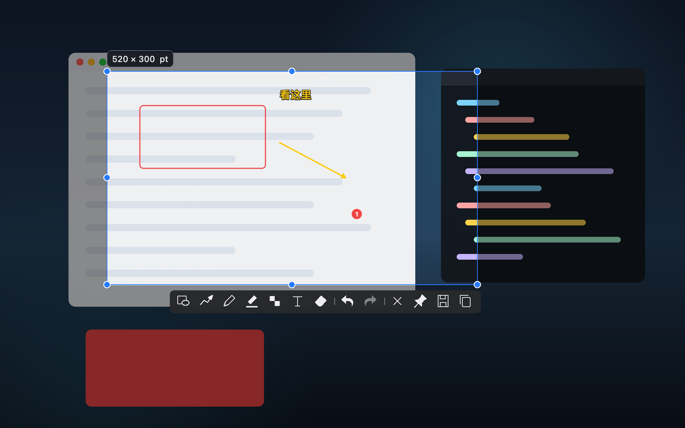
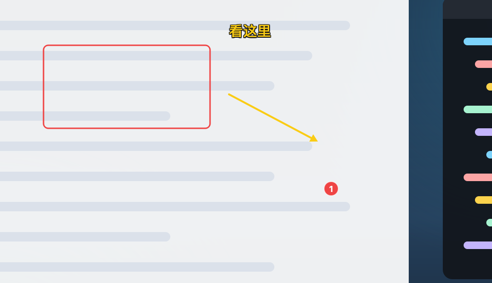
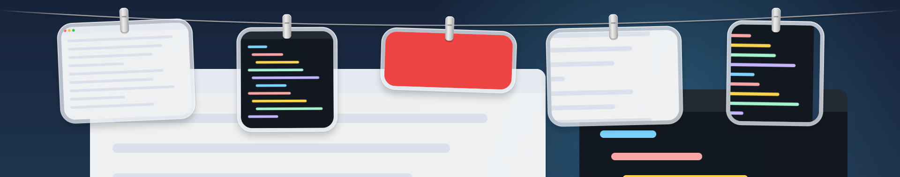
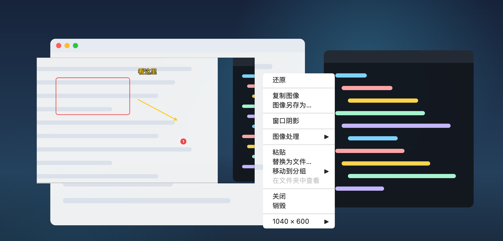
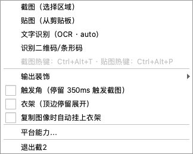
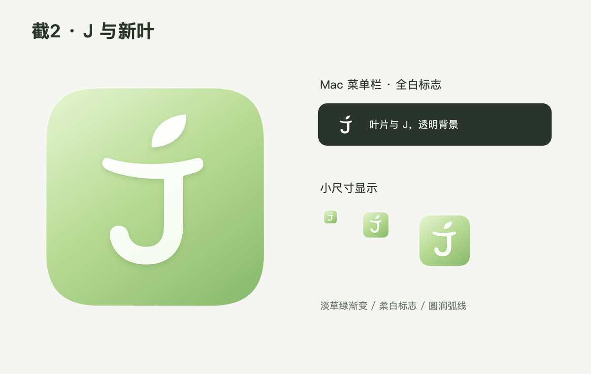

# J2（Jie2）

跨平台截图 / 标注 / 贴图工具。对标 Snipaste 2.x 专业版全功能，
当前发布 **0.0.2**，提供 macOS（arm64）、Linux（x86_64）与 Windows（x64）安装包。

[**下载 0.0.2**](https://github.com/richardguancn/Jie2/releases/tag/0.0.2) ·
[功能完成度](#功能完成度总览收口) ·
[验证状态](#验证状态) ·
[已知缺陷与踩坑记录](#已修掉的真实缺陷累计)

| | 状态 |
|---|---|
| 平台 | macOS 14+ / Windows 10+ / Linux（X11 与 Wayland） |
| 安装包 | dmg + zip、zip（免安装）、deb + rpm + AppImage |
| 界面技术 | Qt 6 Widgets（全自绘），UI 层可整体替换为 QML |
| 内核 | 纯 C++20，不依赖 Qt 与任何系统 API，可脱离 GUI 单测 |
| 依赖 | macOS / Windows 包自包含 Qt；Linux 包用发行版自带 Qt6 |

## 界面

选中区域后按需标注，工具条按功能分组（形状 / 箭头 / 画笔 / 荧光笔 / 图像效果 /
文字 / 橡皮擦，撤销重做，末尾是取消、贴图、保存、复制）：



确认后的输出就是所选区域加标注，所见即所得：



截图挂上衣架：指针停到屏幕顶边展开，卡片可直接复制、双击打开、长按标注。
**系统截图也会自动挂上来**——macOS 的 `⌘⇧4`、Windows 的 `Win+Shift+S` 存盘后
同样出现在衣架上（监听系统截图的保存目录，可在设置里关闭）：



贴图把截好的图钉在屏幕最上层，右键菜单提供图像处理、另存、分组与尺寸：



托盘菜单（各平台走系统原生菜单）：



应用图标与菜单栏标志：



> 上图是用**真实控件离屏渲染**生成的（`tests/ui_alignment_tests.cpp` 的
> `readmeFigures` 用例，设 `JIE2_UI_ARTIFACTS` 即导出），背景是代码画的
> 示意桌面，不含任何真实屏幕内容。

## 安装

**macOS（arm64）** 下载 dmg，把 `jie2.app` 拖进「应用程序」。当前为 ad-hoc 签名、
未做 Apple 公证，首次打开请右键 →「打开」。

**Windows（x64）** 下载 zip 解压到任意目录，双击 `jie2.exe`。常驻托盘、不出主窗口；
不写注册表、不装服务，删除文件夹即卸载。

**Debian / Ubuntu / 麒麟 / 统信** `sudo apt install ./jie2_0.0.2_amd64.deb`
**Fedora / RHEL / openEuler** `sudo dnf install ./jie2-0.0.2-1.x86_64.rpm`
**其他 x86_64 Linux** `chmod +x jie2-0.0.2-x86_64.AppImage && ./jie2-0.0.2-x86_64.AppImage`

默认热键：截图 `Ctrl+Alt+T`、贴图 `Ctrl+Alt+P`、保存剪贴板图像 `Ctrl+Alt+C`
（macOS 上自动改用 `Cmd+Alt+…`，符合本机习惯）。

三个全局热键都可以在「设置 → 快捷键 → 全局快捷键」里改。写法支持
`ctrl`／`alt`／`shift` 与 `cmd`（= `command`／`super`／`win`／`meta`），
主键支持字母、数字与 `F1`–`F12`，必须至少带一个修饰键；三个动作不能重复。
改完立即重新注册，无需重启。

## 架构：三层解耦

```
┌─ ui ──────────────  Qt 6（Widgets / QML 可替换）
│                    托盘、设置界面、衣架外观、贴图窗口
├─ platform ────────  平台集成层（每平台一个实现）
│                    抓屏、全局热键、置顶窗、layer-shell、剪贴板
└─ core ────────────  图像内核（纯 C++）
                     几何、像素缓冲、配置、能力模型；
                     后续：标注渲染、马赛克、模糊、取色、撤销栈、OCR 调度
```

**依赖方向严格向下**：`ui → platform → core`，禁止反向依赖。

这条约束不是洁癖，它对应三个具体的工程目标（评估报告 3.5.3）：

1. **UI 技术可替换** —— 将来若把 UI 层从 Widgets 迁到 QML，只重写 `src/ui`，内核与平台层不动。
2. **平台差异被收敛** —— X11 / Wayland / macOS 的差异只存在于 `src/platform` 的某个实现里，不渗入业务代码。
3. **内核可脱离 GUI 单测** —— `jie2_core` 不依赖 Qt 与任何系统 API，可在无桌面会话的 CI 容器里跑测试。

## 目录结构

```
CMakeLists.txt              顶层工程（Qt 可选：无 Qt 时只构建下两层）
.github/workflows/release.yml  推送版本 tag 即构建三平台安装包并发布
assets/brand/               应用图标与菜单栏标志（SVG 原稿 + 各尺寸 PNG + icns + qrc）
docs/                       各轮的改动 / 验证记录，docs/images 是 README 配图
src/core/                   图像内核（零 UI 依赖）
  geometry.h                Point / Size / Rect
  image_buffer.{h,cpp}      RGBA/BGRA 像素缓冲
  image_ops.{h,cpp}         裁剪/拼接/缩放/像素比对 + 边框/阴影/圆角 + 马赛克/模糊
  annotation.{h,cpp}        标注模型与撤销栈（M2）
  snap.{h,cpp}              窗口吸附几何（M1，纯函数可单测）
  capability.{h,cpp}        平台能力模型（会话类型 + 能力状态 + 摘要文本）
  capture_history.{h,cpp}   截图历史（回放 + 衣架数据源）
  config.{h,cpp}            键值配置（INI 风格，宽松解析）
src/platform/               平台集成层
  platform.h                Platform 接口（探测 / 热键 / 抓屏 / 窗口几何）
  display.h                 显示器与抓屏结果类型
  hotkey.h                  热键描述类型
  factory.cpp               平台分发 + 未支持平台兜底实现
  macos/macos_platform.mm   Carbon 热键 + CGDisplay 抓屏 + CGWindowList 窗口枚举
  linux/linux_platform.cpp  X11 XGrabKey + XGetImage 抓屏 + XQueryTree 窗口枚举
src/ui/                     UI 层（唯一允许使用 Qt 的地方）
  main.cpp                  GUI 入口（托盘常驻 + 自动化验证入口）
  tray.{h,cpp}              托盘控制器（截图/装饰/触发角/衣架/贴图/OCR）
  selection_overlay.{h,cpp} 截图选择遮罩（框选/吸附/放大镜/回放/12 键标注工具条）
  annotation_render.{h,cpp} 标注渲染（矢量 QPainter + 像素效果合成）
  clothesline.{h,cpp}       衣架（M3，tendedero 合并）
  flight_overlay.{h,cpp}    截图飞入衣架的飞行覆盖层
  pin_window.{h,cpp}        贴图窗口（M4：置顶/旋转/翻转/缩放/透明度/穿透/反色/局部）
  ocr_runner.{h,cpp}        大模型文字识别与翻译（保留旧本地命令行兼容入口）
  settings_dialog.{h,cpp}   六页设置窗口与配置保存
  single_instance.{h,cpp}   单实例命令通道（QLocalSocket）
  theme.{h,cpp}             主题解析（配置 > 环境变量探针 > 系统探测）
src/tools/                  CLI 工具（不链接 Qt）
  probe_main.cpp            jie2-probe：平台能力/抓屏/窗口枚举，CI 与现场诊断
  jie2_line.cpp             Wayland layer-shell 顶部条（独立进程渲染衣架）
tests/
  core_tests.cpp            内核单元测试（几何/缓冲/配置/能力/吸附/标注）
  ui_alignment_tests.cpp    界面测试（工具条布局/手势/标注合成/衣架/贴图/菜单）
scripts/
  package-macos.sh          macOS 自包含打包（zip + dmg）
  package-windows.sh        Windows 自包含打包（zip，含 MinGW 运行时）
  build-deb.sh              构建 deb
  build-rpm.sh              构建 rpm
  build-appimage.sh         构建自解压 AppImage
  verify-linux-aarch64.sh   Linux ARM64 构建+验证（容器）
  verify-windows-cross.sh   Windows 后端交叉编译验证（双工具链 + 导入表）
  test-interactive-linux.sh 交互链路 E2E（选择→绘制→撤销→重做→保存）
  test-snap-linux.sh        窗口吸附 E2E
  test-clothesline-linux.sh 衣架 E2E（展开/复制/收起）
  color_window.c            确定色靶窗（抓屏像素验证用）
  window_target.c           普通顶层窗口（吸附验证用）
  mouse_tool.m              macOS 合成鼠标/键盘（交互验证用）
```

版本号唯一来源是 `CMakeLists.txt` 的 `project(... VERSION ...)`：
四个打包脚本都从这一行解析版本，发布流水线还会校验 tag 与它一致，
不一致直接失败 —— 避免产出名不符实的安装包。

## 构建

### macOS

```bash
brew install qtbase cmake          # qtbase 是 qt 拆分后的主模块，省掉 webengine 等大包
cmake -S . -B build-macos -DCMAKE_BUILD_TYPE=RelWithDebInfo \
      -DCMAKE_PREFIX_PATH="$(brew --prefix qtbase)"
cmake --build build-macos -j
```

### Linux（含 aarch64）

```bash
sudo apt install build-essential cmake qt6-base-dev qt6-qpa-plugins \
    libgl1-mesa-dev libx11-dev libxrandr-dev libxkbcommon-dev \
    libdbus-1-dev zlib1g-dev libwayland-dev wayland-protocols
cmake -S . -B build-linux -DCMAKE_BUILD_TYPE=Release
cmake --build build-linux -j$(nproc)
```

缺少 `wayland-client` / `wayland-scanner` 时自动跳过 `jie2-line`（Wayland 顶部条），
缺少 `libdbus-1` / `zlib` 时自动关闭 Wayland 门户能力 —— 都会在 CMake 配置输出里
说明原因，不会静默假装可用。

### Windows（x64，MSYS2 / MinGW-w64）

在 MSYS2 的 UCRT64 shell 中：

```bash
pacman -S mingw-w64-ucrt-x86_64-gcc mingw-w64-ucrt-x86_64-qt6-base \
          mingw-w64-ucrt-x86_64-qt6-tools mingw-w64-ucrt-x86_64-cmake \
          mingw-w64-ucrt-x86_64-ninja zip unzip
cmake -S . -B build-windows -G Ninja -DCMAKE_BUILD_TYPE=Release \
      -DCMAKE_PREFIX_PATH="$(cygpath -m /ucrt64)"
cmake --build build-windows
```

Qt6 缺失时仍可构建 `core` / `platform` / `tools` / `tests`（UI 层自动跳过）。

## 打包与发布

```bash
bash scripts/package-macos.sh   build-macos   dist   # → jie2-<版本>-macos-<架构>.zip / .dmg
bash scripts/package-windows.sh build-windows dist   # → jie2-<版本>-windows-x64.zip
bash scripts/build-deb.sh       build-linux   dist
bash scripts/build-rpm.sh       build-linux   dist
bash scripts/build-appimage.sh  build-linux   dist
```

推一个与项目版本一致的 tag 即触发 GitHub Actions：

```bash
# 改版本号（CMakeLists.txt 的 VERSION）→ 提交 → 打 tag
git tag -a 0.0.2 -m "J2 0.0.2" && git push origin 0.0.2
```

流水线（`.github/workflows/release.yml`）分别在 ubuntu-24.04、macos-14、
windows-2022 上构建并跑 `ctest`，再打包、汇总到 Releases。
`workflow_dispatch` 手动触发时只构建不发布，可用来先验流水线。
同一个 tag 重跑时只补全附件，不覆盖人工维护的发布说明。

## 验证

```bash
# 单元测试 + 界面测试（界面测试走离屏，无需桌面）
ctest --test-dir build-macos --output-on-failure

# 平台能力探测（无 GUI 依赖）
./build-macos/src/tools/jie2-probe

# 全局热键注册实测（Linux 下建议在 Xvfb 或有 X 会话中运行）
./build-macos/src/tools/jie2-probe --test-hotkey

# 导出界面测试里的截图与 README 配图
JIE2_UI_ARTIFACTS=/tmp/jie2-ui ctest --test-dir build-macos -R ui_alignment
```

`ui_alignment_tests` 覆盖：工具条在 1280×800 / 480×320 / 320×480 下不出界且按钮可命中、
选区八手柄缩放与整体拖动（含"选过标注工具后仍可拖"与命中区尺寸）、
保存/复制/贴图三个动作互不串台、标注与撤销重做、保留原图分辨率、
衣架单击/双击/长按语义与菜单项、贴图右键菜单与局部模式、
全局快捷键解析与设置校验（macOS 认 `cmd`、非法格式与重复组合被拒）、
系统截图目录监听（旧文件不挂、普通图片不误挂、新截图自动上架）、
遮罩请求平台层提升窗口层级，以及用真实控件离屏渲染 README 配图。

`--test-hotkey` 会做两次注册：首次注册同一组合，若系统层面真的生效，
第二次会被拒绝（macOS 返回 `eventHotKeyExistsErr`），这是"注册成功"的独立佐证。

```bash
# 截图遮罩的窗口层级提升自检（全屏 / 远程桌面场景）：
# 建一个与遮罩同类的窗口交给平台层提升，打印结果。返回 2 表示当前会话
# 不支持（Wayland 合成器限制），返回 0 表示提升调用成功。
./build-macos/src/ui/jie2.app/Contents/MacOS/jie2 --test-overlay-promote
```

> 该自检能证明「原生窗口句柄可解析、层级设置调用成功」，
> **不能**证明「确实盖住了某个全屏/远程桌面窗口」—— 那需要人眼在实际
> 远程桌面会话中确认。

### Linux aarch64 容器验证

```bash
docker run --rm -v "$PWD":/work -w /work ubuntu:24.04 \
    bash scripts/verify-linux-aarch64.sh
```

## 平台能力模型

`PlatformCapabilities` 如实报告当前会话下每项能力的真实状态，
而不是假设"代码写了就一定可用"（评估报告 3.2 要求降级必须对用户可见）：

| 状态 | 含义 |
|---|---|
| `available` | 直接可用，无额外授权 |
| `degraded` | 可用但受限（需授权 / 每次弹窗 / 功能缩水） |
| `unavailable` | 当前会话不可用 |
| `n/a` | 该平台无此概念（如 macOS 没有 layer-shell） |

已知的平台差异（M0 实测）：

| | macOS | Linux X11 | Linux Wayland |
|---|---|---|---|
| 抓屏 | 需屏幕录制权限（真实探测） | XGetImage 直通 | **portal Screenshot（已实现，可能弹一次授权）** |
| 全局热键 | Carbon | XGrabKey | **portal GlobalShortcuts（已实现）** |
| 置顶窗 | NSWindow level | EWMH | 合成器相关 |
| 顶部条 | NSPanel | 置顶窗 | layer-shell（GNOME 不支持） |

## 验证状态

下表是逐项实测记录：每一行都对应一个可复现的验证脚本或测试用例，
"✅" 表示亲眼看过输出（像素断言 / 日志 / 产物），不是"代码写了"。

| 项目 | macOS arm64 | Linux（aarch64 / x86_64） |
|---|---|---|
| 全量构建（core/platform/ui/tools/tests） | ✅ 本机 + macos-14 CI | ✅ 容器 + ubuntu-24.04 CI |
| 内核单元测试 / 界面测试 | ✅ 均通过 | ✅ 均通过 |
| 平台探测 | ✅ 真实读取系统版本 / 屏幕数 / 屏幕录制权限 | ✅ X11 / Wayland / 无会话 三态均正确 |
| 全局热键注册 | ✅ Carbon（二次注册被系统以 `eventHotKeyExistsErr` 拒绝，作为独立佐证） | ✅ XGrabKey（Xvfb 虚拟 X11 下实测） |
| GUI 启动冒烟 | ✅ | ✅（Xvfb） |
| Wayland 降级如实报告 | — | ✅ 四条能力逐条标注受限原因 |
| **抓屏：全屏** | ✅ 3420x2214（2x Retina） | ✅ 640x480（Xvfb） |
| **抓屏：区域** | ✅ 100x100 逻辑点 → 200x200 物理像素 | ✅ 100x100（X11 无缩放，1:1） |
| **抓屏：像素级正确性** | ✅ 与系统 `screencapture` 逐点比对：57 点零差异 | ✅ 与 `xwd` 双工具对照：已知色窗口 #FF0000 / #00FF00 完全一致 |
| **截图链路：UI 层**（抓屏→QImage→PNG→剪贴板） | ✅ `--capture-once` 产出 3420x2214 PNG；与系统工具再比对：35 点平均差 0.17 | ✅ `--capture-once` 产出 640x480 PNG，中心像素 = 靶色 |
| **选择遮罩：像素精确裁剪** | ✅ 靶窗内 100×100 逻辑点 → 200×200 全同色（40000 像素零杂色）；边界恰在 x=19/20 之间 | ✅ 蓝靶块内 400 采样全 (0,0,255)；块外全黑 |
| **选择遮罩：交互流程** | ✅ 拖拽→尺寸标签→回车→保存文件恰为标签尺寸 | ✅ Xvfb 下遮罩启动稳定（无真实鼠标，交互部分由 macOS 侧覆盖） |
| **选择遮罩：工具条** | ✅ 点击「保存」按钮 → 1402×802 与标签一致 + 剪贴板同步 | —（按钮位置由 macOS 侧覆盖） |
| **选择遮罩：脚本入口** | ✅ `--select-rect x,y,w,h` | ✅ `--select-rect` 输出与靶色一致 |
| **历史回放 + 裁剪**（`,`/`.` → 拖拽 → 保存） | ✅ **逐像素零差异**（1681/1681 像素一致） | ✅ **逐像素零差异**（1681/1681，且跨色块边界验证对齐） |
| **F5 刷新截图** | ✅ 隐藏遮罩→重抓→恢复，日志确认 | ✅（同一代码路径） |
| **输出装饰**（圆角+边框+阴影） | ✅ 200×200 → 276×276；中线恰 20 个绿色边框像素（10px×2 边）；四角透明 | （同一内核函数，见下） |
| **色彩管理**（sRGB 嵌入） | ✅ PNG 含 `iCCP` 块（288B），`sips` 报告 `profile: sRGB` | —（Qt 同一写码路径） |
| **窗口吸附** | ✅ 候选 7 窗口；判定逻辑单测覆盖 7 组场景 | ✅ **E2E**：拖至 (996,436) → 精确吸附到窗口边缘 (1000,440) |
| **触发角** | ✅ 停留后日志"触发角触发截图"→ 遮罩打开（候选 7 窗口） | （同一代码路径） |
| **标注合成**（矩形/椭圆/箭头/马赛克/模糊） | ✅ 逐像素：边框色精确 (239,68,68)、椭圆顶点色精确、箭头 404 蓝像素、马赛克块内 100/100 同色、模糊区平滑 | ✅ 同断言通过（`--test-annotate`） |
| **标注交互 E2E**（选择→绘制→撤销→重做→换色→保存） | —（激活限制，交互由 Linux 侧覆盖） | ✅ 完整通过：选区 400×300、矩形 151/151 红像素、箭头 390 黄像素、输出尺寸精确 |
| **衣架 E2E**（展开/复制/收起） | ✅ 展开/收起逻辑（日志），抖动修复后单次展开；tendedero 样式离屏渲染逐像素验证（抛物线绳/衣夹/三色卡片/透明区） | ✅ **完整通过**：2 项初始化、顶边展开、点击复制（剪贴板 465B PNG）、离开收起；绳芯/衣夹亮像素/透明区透出桌面逐项命中 |
| **贴图变换 M4**（旋转/翻转/反色） | ✅ 逐像素：90°顺时针后四象限位移精确、水平翻转 TL↔TR 互换、反色红→青 | ✅ 同断言通过（`--test-pin`） |
| **标注增补 M2**（文字/序号） | ✅ 文字 404 红像素、序号圆 (239,68,68) + 白色数字 46 像素 | ✅ **E2E**：文字输入框收到键入 "TEST"（119 黄像素）、两次点击生成序号 1/2（572/553 黄像素） |
| **OCR M5** | ✅ 系统 Vision：`HELLO WORLD 123` 精确识别 | ✅ tesseract：同结果；自定义命令行后端（真实脚本）：同结果；auto 回退链正常 |
| **命令行 M6** | ✅ `--output` 存到指定路径（240×160 精确）；`--round 12 --border 6 --shadow` 组合生效（160×120→228×188，四角透明） | （同一代码路径，见 macOS 列） |
| **橡皮擦 / 圆角 / 虚线 M2** | ✅ 圆角矩形角点无线、边中点有像素；虚线有无交替 14 次（是真虚线） | ✅ **E2E**：画矩形 → 橡皮擦拖过后该区域红色像素 0 |
| **椭圆形状 / 双向箭头 / 放大镜 M2** | ✅ 逐像素：椭圆马赛克中心 (127,0,127)、椭圆四角保留原噪声；双向箭头两端各 113+ 黄像素；放大镜块左白右黑（跨分界的源区被真实放大 2x） | ✅ 同断言通过 + 核心椭圆掩码单测 |
| **衣架动画 M3** | ✅ 展开/收起逻辑 | ✅ **逐帧**：y 采样 -210→-196→…→0（15 个中间位置）；滑出对称 |
| **剪贴板监听 / 拖出 M3** | — | ✅ **E2E**：xclip 写入红图 → 历史 +1 且带 copied 前缀；按住卡片拖动触发 QDrag；无接收者时卡片保留 |
| **白板 / --size / --active-screen M6** | ✅ `--size`：120×80 → 200×100 | ✅ **E2E**：白板蓝底 + 红色标注（724 像素）→ 保存 400×320；`--size` 60×40→180×90 |
| **条码识别 M6** | （需装 zbar：`brew install zbar`） | ✅ **E2E**：qrencode 生成二维码 → 内容精确匹配；`--barcode-decode` 读出 URL；无码图不误报 |
| **贴图分组 M4** | ✅ 12 项断言全过（建组/切组/可见性/循环） | ✅ 同断言通过 |
| **调色板配置 M2** | （同代码路径） | ✅ **E2E**：palette_size=3 → 黄/绿/红/黄 循环，第 4 次回到第 1 色 |
| **Wayland GlobalShortcuts M7** | — | ✅ **E2E（mock 门户）**：能力探测识别服务（version=2）、绑定成功、Activated 触发回调、触发串 "CTRL+ALT+t" 正确、拒绝场景如实失败；**25 轮连续通过** |
| **Wayland Screenshot M7** | — | ✅ **E2E（mock 门户 + 像素核对）**：全屏抓取（源图 5 种行滤波轮转、4 点像素核实）、区域裁剪（2 点核实）、越界/取消如实失败；**5 轮连续通过** |
| **打包 M7** | ✅ **自包含包**：`--bundle-qt` 产出 12MB zip（5 个 Qt 框架 + 9 个插件 + 重签名）；dyld 验证全部从包内加载；GUI 运行正常 | ✅ **双格式**：deb（2.4MB，安装后运行正常）+ AppImage 风格自解压包（3.7MB，GUI 冒烟通过、`--version` 正常） |
| **单实例 IPC**（唤起/命令送达） | ✅ **E2E**：`--empty-group` 送达执行、二次启动唤起、实例数=1 | ✅ **E2E**：合成热键贴 1 张真实贴图 → 命令清空它 → 二次启动唤起 → 无实例清晰报错 |
| **形状记忆颜色**（专业版 v2.4） | — | ✅ **E2E**：4 色场景矩形推进到绿 → 椭圆独立从黄开始 → 切回矩形续蓝 |
| **贴图全选拖动**（专业版 v2.4） | — | ✅ **E2E**：3 张同步位移 (120,60)；取消全选后不再联动 |
| **贴图 Esc 自定义**（专业版 v2.8） | — | ✅ **E2E**：默认 Esc 关闭销毁；`esc=hide` 配置下只隐藏（窗口保留不可见） |
| **--keep-aspect-ratio**（v2.8.6） | ✅ 80×20 源 + 200×70 → 200×50（保 4:1） | 同左（共用输出管线） |
| **Ctrl+Alt+C 保存剪贴板图像**（v2.5） | ✅ 三个热键（T/P/C）macOS 注册成功 | ✅ **E2E**：两张图各存一次、原始尺寸；无图时不静默 |
| **标注自由选中/二次编辑**（v2.8） | ✅ 构建通过（共用标注层） | ✅ **E2E**：选中→Delete（输出零红像素）→方向键位移（像素级 100→120） |
| **缩略图快捷键自定义**（v2.11） | — | ✅ **E2E**：默认 Shift+双击缩略图；配 ctrl 后 Ctrl 有效、Shift 回落关闭 |
| **layer-shell 顶部条**（Wayland 衣架） | —（macOS 无此概念） | ✅ **五项全过**（Sway 真实合成器）：自动切换 / items 文件 / 无孤儿 / 输出像素（缩略图色值精确）/ 层叠语义（盖住普通窗口） |
| **贴图分组管理窗口** | — | ✅ `--show-group-manager` 可重复打开（Esc 关闭后主实例存活） |
| **Windows 后端** | — | ✅ **已在真实 Windows 运行**（windows-2022 runner）：能力探测报告抓屏/热键/置顶均可用，显示器枚举 1 块 1024×768，`--capture` 抓到 1024×768 BGRA 且四角与中心为真实桌面颜色，`--windows` 枚举到 3 个可吸附窗口；此前另有双工具链交叉编译 + 导入表检查 |
| **界面测试**（`ui_alignment_tests`） | ✅ 工具条三分辨率布局 / 选区手柄 / 三动作互不串台 / 标注撤销重做 / 衣架手势 / 贴图菜单与局部 | ✅ 同上（ubuntu-24.04、windows-2022 CI 与 Debian aarch64 容器均通过） |
| **发布流水线**（tag → 三平台安装包） | ✅ macOS arm64 zip/dmg | ✅ Linux x86_64 deb/rpm/AppImage；Windows x64 zip（CI 实跑，导入表核对 17 个非系统 DLL 全部随包） |

Windows x64 单独列（结果来自 windows-2022 runner 上的实跑日志）：

| 项目 | 结果 |
|---|---|
| 构建与测试 | ✅ 从零构建通过；`core_tests`、`ui_alignment_tests` 均通过 |
| 平台能力探测 | ✅ 抓屏 / 全局热键 / 置顶窗 / 剪贴板均报告 `available`，`has-limitations: false` |
| 显示器枚举 | ✅ 1 块，`1024x768+0+0 scale=1.00 (primary)` |
| 抓屏 | ✅ `capture: ok 1024x768 bgra`，四角与中心采样为真实桌面颜色 |
| 窗口枚举（吸附用） | ✅ `windows: 3` |
| 打包完整性与依赖 | ✅ `unzip -t` 无错；导入表核对 17 个非系统 DLL 全部在包内 |

抓屏验证细节：

- **macOS 交叉验证**：用系统自带 `screencapture` 抓同一屏，转 BMP 后与我们的
  PPM 逐点比对（57 个采样点，含四角/中心/随机点）——最大通道差 **0**。
- **Linux 已知色验证**：`scripts/color_window.c` 创建一个确定颜色的
  override-redirect 窗口作为靶子（在 Xvfb 下 `xsetroot` 对 root window
  的着色读不到，必须用真实窗口），jie2 与 `xwd` 双工具结果一致。
- **macOS 两个反直觉的实测结论**（已写入代码注释，避免后人踩坑）：
  1. `CGDisplayPixelsWide` 在 macOS 27 返回逻辑点而非物理像素，
     缩放比例须改用 `CGDisplayMode` 计算。
  2. `CGDisplayCreateImageForRect` 的 rect 参数用**逻辑点**，
     返回图像却是**物理像素**（1710x1107 输入 → 3420x2214 输出）。

> 排障开关：Linux 抓屏加 `JIE2_X11_DEBUG=1` 可打印 XImage 的
> 位深 / 字节序 / 掩码 / 首字节，便于在不同 X 服务器上核对布局。

实测环境：

- macOS：macOS 27.0.1 / arm64 / Qt 6.11.2（`qtbase`，见下方说明）
- Linux：Debian 12 (bookworm) / **aarch64** / Qt 6.4.2 / libx11-dev / Xvfb

> macOS 上 Qt 6 通过 `brew install qtbase` 安装（只需 Core/Gui/Widgets）。
> 安装时为解决与 `qt@5` 的链接冲突执行过 `brew unlink qt@5` ——
> 该操作只移除符号链接，Qt 5 文件仍保留在 Cellar，需要时用
> `brew unlink qtbase && brew link qt@5` 切回。

## 里程碑

见评估报告第五节。已完成：

- **M0 骨架** —— 三层结构、平台探测、全局热键（两平台实测通过）、托盘、配置持久化。
- **M1a–M1d 抓屏地基** —— 图像内核（裁剪/拼接/缩放/像素比对）、平台层抓屏接口、
  macOS 与 Linux X11 双实现、双平台像素级验证（见上表）。
  命令行可试：`jie2-probe --displays`、`--capture`、`--capture-region x,y,w,h`、
  `--capture-save out.ppm`、`--windows`（可吸附窗口列表）。
- **M1e-1 截图闭环** —— 托盘菜单「截图」、全局热键 `Ctrl+Alt+T` 触发截图、
  保存至图片目录 `jie2/` 子目录并写入剪贴板；`jie2 --capture-once` 为自动化验证入口。
- **M1e-2 截图选择 UI** —— 全屏冻结遮罩：拖拽框选、选区外变暗、实时尺寸/起点标签、
  **可视化工具条（保存 / 取消按钮，点击优先于拖拽，避免误清选区）**、
  4x 放大镜 + 光标色值（按 `C` 复制）、回车/双击确认、Esc/右键取消；
  保存与剪贴板复用同一条落点链路。脚本入口 `--select-rect x,y,w,h`
  （供自动化与 M6 命令行复用；`--select` 打开交互遮罩）。

- **M1e-3 截图历史回放** —— `,`/`.` 在遮罩内回放最近 16 张截图（历史持久化在配置目录
  `history.txt`）；选历史图后保存，内容从历史文件裁剪（非当前屏）。双平台逐像素验证。
- **M1e-4 F5 刷新截图** —— 遮罩内按 F5 重新抓屏；实现上先隐藏遮罩、等合成器完成
  一次合成（150ms）再抓，避免把遮罩自己拍进去。
- **图像内核装饰函数**（M1 输出项的基础件）—— `addBorder` / `addShadow` /
  `roundCorners` / `pixelate`（马赛克）/ `boxBlur`（高斯模糊近似，三次 box blur），
  全部纯 C++、带单测。UI 接线（截图时应用边框/阴影/圆角）为下一项。

- **M1 收尾四项（全部完成）**——
  - **输出装饰 UI 接线**：托盘菜单「输出装饰」开关圆角（半径可配）/边框（宽度、颜色）/
    阴影；按「圆角 → 边框 → 阴影」顺序在保存链路上应用。
  - **窗口吸附**：平台层新增 `windowRects()`（macOS `CGWindowListCopyWindowInfo`、
    X11 `XQueryTree`），拖拽时四边各自吸附到窗口边缘（8pt 阈值），
    吸附边有高亮指示；吸附几何抽为 `core::snap` 纯函数并单测。
  - **触发角**：屏幕角落停留（可配时长/尺寸/角落组合）触发截图，
    触发后需离开角落才重新武装；遮罩打开期间自动抑制。
  - **色彩管理**：保存时嵌入 sRGB（PNG `iCCP` 块；`sips` 报告 `profile: sRGB`）。
- **M2 标注（核心工具完成）**—— 选择遮罩内置 12 键工具条：
  矩形 / 椭圆 / 箭头 / 铅笔 / 马克笔 / 马赛克 / 模糊 + 撤销 / 重做 / 颜色 / 保存 / 取消；
  程序化验证入口 `jie2 --test-annotate <out.png>`。
  撤销重做（Ctrl+Z / Ctrl+Shift+Z）、滚轮调粗细、数字键 1-7 切工具。
- **M3 衣架（tendedero 合并，完整）**—— 顶部条带窗口：指针停到屏幕顶边**滑入动画**展开，
  展示最近截图缩略图；单击复制回剪贴板、右键从衣架取下（文件保留）、
  指针离开或 Esc **滑出动画**收起；截图前自动收起（避免被拍进截图）。
  - **tendedero 样式**（外观 1:1 对齐其 LineView/PeggedView）：**透明面板**
    （桌面壁纸透出，无不透明色板）、**抛物线晾衣绳**（下垂量 min(30, 宽×1.8%)，
    三层描边 = 投影 + 中性灰芯 + 顶部高光，两端淡出）、**铝质衣夹**
    （9×26 拉丝金属胶囊，绳子从槽中穿过）、**玻璃卡片**（边框贴着照片宽高比、
    同心圆角 16/12、顶部受光描边、柔和投影）、每张卡片带 **±2.5° 固定倾斜角**
    （由路径哈希确定，同一文件角度稳定）；卡片**居中排布**，过密时间距压缩；
    悬停放大 1.035、按下缩 0.95。
  - **滑入滑出动画**：定时器驱动的窗口位移（12ms 步进、14px/步）。逐帧采样验证：
    收起态 y=-210 → -196 → … → -14 → 0，确证是逐步动画而非跳变。
  - **拖出保存**：按住卡片拖到文件管理器/聊天窗口 —— 文件 URL + 图像双载荷；
    对方以 MoveAction 接收时卡片下线（对齐 tendedero 的 "Drag into a folder"）。
  - **剪贴板图像监听**：复制图像（截图工具、浏览器等）自动挂上衣架，
    对齐 tendedero 的 "Hang copied images"。带文本/URL 的复合内容跳过（避免误挂）；
    内容级去重（32×32 摘要），自己写入剪贴板的内容不会被再次挂载。
- **M2 标注增补（文字 / 序号 / 橡皮擦 / 圆角 / 虚线完成）**—— 工具条扩到 15 键（10 工具 + 撤销/重做/颜色/保存/取消）：
  - **橡皮擦**：按住拖过标注即整条删除（半透明提示语义：矢量标注被擦一半没有合理语义，
    按"包围盒相交即整条删"工作）；擦除会清空 redo 栈（与"新添加即清空"一致）。
  - **虚线样式**：`D` 键切换，作用于矩形/椭圆/箭头/铅笔/折线（专业版对齐项 v2.5）。
  - **圆角矩形标注**：`R` 键循环半径 0/8/16/24（专业版对齐项 v2.4）。
  - **文字**：选区内点击弹出内联输入框（回车提交 / Esc 取消），带描边保证任意底色可读；
    按 `T` 快速切换；字号随"粗细"维度调节（滚轮/数字键）。
  - **序号**：点击放置自动编号的圆形标记（1、2、3…）；编号基于当前可见数量，
    撤销后编号自动重用；按 `N` 快速切换。
  - **椭圆形状**（`O` 键，专业版 v2.6）：马克笔/马赛克/模糊/橡皮擦以椭圆工作；
    椭圆掩码语义在核心里单测（中心被处理、四角保留原像素）。
  - **箭头样式**（专业版 v2.5）：`B` 双向箭头、`Shift+B` 反向箭头。
  - **放大镜标注**（`M` 键，专业版 v2.6）：拖出源区域，合成时将该区域内容
    放大 N 倍呈现（源框与放大块都有描边，位置自动收进画布）。
- **M4 贴图（核心完成）**—— `Ctrl+Alt+P` 或托盘菜单把剪贴板内容贴成置顶窗口：
  - 来源（对齐 Snipaste 五类）：图像 / 纯文本（渲染为图片）/ 颜色值（色块 + HEX 标注）/
    图像文件路径（加载图像）/ 非图像文件路径（当文本贴出）
  - 操作：滚轮或 `+`/`-` 缩放、`1`/`2` 旋转、`3`/`4` 翻转、`Ctrl+滚轮`透明度、
    `6` 反色、中键重置 100%、`Shift+双击` 缩略图模式、拖动移动、`Esc` 关闭、裸双击以点击处为中心切换方形局部（再次双击恢复完整图片）
  - 鼠标穿透（`Qt::WindowTransparentForInput`）、隐藏/显示全部、关闭全部、
    保存全部（批量保存到截图目录，`saveTo` 单张/批量共用同一路径）
  - 变换是像素精确的：对 90° 旋转用整数变换（非插值），逐像素验证通过
- **M5 OCR 子系统（历史实现；当前默认大模型，见上方设置说明）**—— 可插拔后端（评估报告 4.4）：
  - **系统后端**：macOS Vision（离线、零配置，实测 "HELLO WORLD 123" 精确识别）
  - **tesseract**：跨平台离线（aarch64 由发行版提供），CLI 后端
  - **自定义命令行**：stdin 收 PNG / stdout 出文本的契约，示例脚本 `scripts/ocr-custom-example.sh`
  - **OpenAI 兼容端点**：自定义 base_url + model + key（云端，使用前弹窗确认"会上传图像"）
  - auto 模式回退链：系统 → tesseract，两条失败时把两条原因都报出来
  - 入口：托盘菜单「文字识别（OCR）」，结果写回剪贴板
- **M6 命令行（专业版选项对齐）**—— 脚本化输出、装饰覆盖与自动化入口：
  - `--output <path>` / `-o <path>`：显式输出路径（按扩展名存 PNG/JPEG）
  - `--no-save`：只写剪贴板不落盘
  - `--shadow` / `--no-shadow` / `--border N` / `--round N`：本次调用的装饰覆盖
    （不写入配置文件 —— 命令行调用不改变用户的持久设置）
  - `--size W H`：强制输出尺寸（实测：60×40 源 → 180×90 输出）
  - `--keep-aspect-ratio`（专业版对齐项 v2.8.6）：配合 `--size` 等比缩放到
    W×H 内（实测：80×20 源 + 200×70 目标 → 200×50，保持 4:1）
  - `--active-screen`：用光标所在屏而非主屏
  - `--hold`：截图后先标注再输出（等价于打开交互遮罩，对齐 Snipaste 的 `snip --hold`）
  - `--block [SECONDS]`：兼容参数（本 CLI 天然同步，命令返回即完成）
  - `--whiteboard [color]`：**白板模式** —— 纯色画布 + 全套标注工具，保存标注结果
    （实测：蓝底画布 + 红色矩形，输出 400×320 且底色/标注逐像素正确）
- **M2 增补：调色板数量可配置**（专业版对齐项）—— 10 色内置调色板，
  配置 `annotation.palette_size` 控制循环数量（2~10）。
  实测：设为 3 时颜色按 黄→绿→红→黄 循环，第 4 次回到第 1 色。
- **M2 增补：形状记忆颜色**（专业版对齐项 v2.4：为不同标注形状分别记忆颜色）——
  调色板索引按工具独立存储：切换工具各自的颜色不变、切回继续。
  实测 4 色场景（`scripts/test-color-memory-linux.sh`）：矩形推进到绿后，
  切椭圆是椭圆自己的第 1 次（黄），切回矩形继续第 3 次（蓝）。
- **M2 增补：自由选中 / 二次编辑**（专业版对齐项 v2.8：Ctrl+点击选择单个
  标注进行二次编辑）—— Ctrl+点击命中已有标注则选中（虚线框 + 四角标记，
  从最上层往下找、4px 宽容）；选中后 Delete 删除、方向键微移（Shift=10px）。
  实测（`scripts/test-annotate-select-linux.sh`）：选中日志精确（1/1 矩形）→
  Delete 后输出图**零红像素**（真删了）→ Right×20 后输出图矩形左边缘
  100→120（像素级验证位移生效）。
- **M4 增补：贴图分组管理**（专业版对齐项）—— 默认 3 组，托盘菜单「贴图分组」切换；
  只显示当前组的贴图、其余隐藏（保留在内存与列表）；"隐藏全部"与分组正交。
  实测 12 项断言：建 2 张 → 组 0 可见 2；切组 1 → 可见 0；组 1 建 1 张 → 可见 1；
  切回组 0 → 可见 2；"下一组"循环正确。
- **M4 增补：贴图全选与拖动联动**（专业版对齐项 v2.4：Ctrl+A 全选贴图）——
  在任一贴图上 Ctrl+A 全选/取消全选（Toggle）；全选后拖动任一贴图，
  其余选中贴图同步位移（选中态画高亮边框）。
  实测（`scripts/test-pin-select-linux.sh`）：三张同步位移 (120,60) 完全一致；
  取消全选后再拖动不再联动。
- **M4 增补：Esc 行为自定义**（专业版对齐项 v2.8：可自定义贴图 Esc 和
  Shift+Esc 的功能）—— 配置 `pin.esc_action` / `pin.shift_esc_action`
  （close = 关闭并移除 | hide = 隐藏保留，可由托盘「显示全部贴图」恢复）。
  实测两场景（`scripts/test-pin-esc-linux.sh`）：默认 Esc=关闭（窗口销毁）；
  配 esc=hide 后 Esc 只隐藏（窗口保留、不可见）。
- **M4 增补：缩略图快捷键自定义**（专业版对齐项 v2.11：可自定义贴图选区
  缩略图的快捷键）—— 配置 `pin.thumbnail_modifier`（shift 默认 | ctrl | alt）：
  修饰键+双击切换缩略图；非配置的修饰键+双击回落到"关闭"语义。
  实测（`scripts/test-pin-thumbnail-linux.sh`）：默认 Shift 有效；
  配 ctrl 后 Ctrl 生效、Shift 回落关闭。
- **M4 增补：Ctrl+Alt+C 保存剪贴板图像为文件**（专业版对齐项 v2.5）——
  新全局热键：把剪贴板中的图像直接落盘（复用截图输出管线：装饰/尺寸/色彩
  标记，但**不回写剪贴板**——源本来就是剪贴板内容）。
  实测（`scripts/test-clipboard-save-linux.sh`）：两张不同尺寸的图各保存
  一次、尺寸与原图一致；剪贴板无图时给出提示不静默。
- **M2 增补：快照式撤销 + 橡皮擦可撤销 / 可禁用**（专业版对齐项 v2.6：
  对橡皮擦工具禁用二次编辑）—— 撤销栈升级为**整表快照**：擦除、平移、
  删除都逐步可回退；默认擦除**可撤销**（Ctrl+Z 恢复），配置
  `annotation.eraser_disable_reedit=true` 后擦除永久生效（被擦标注从
  整个历史剔除 —— 撤销/重做循环都不会复活，其它编辑照常可撤销）。
  实测（`scripts/test-eraser-tools-linux.sh`）：默认"擦除→撤销"后输出图
  恢复 **228** 个红色像素；禁用后同流程输出 **0** 像素（永久删除）。
- **M2 增补：橡皮擦区域可旋转**（专业版对齐项 v2.6："矩形/椭圆区域橡皮擦
  可旋转"）—— `Shift+]` / `Shift+[` 以 15° 步进旋转橡皮擦命中区域
  （X11 下 Shift+] 送达的是花括号键值，已做归一化 —— 实测教训）；
  命中测试升级为**凸多边形 SAT**（旋转矩形 4 边形 / 椭圆 24 边形），
  顺带修复旧实现"零宽零高标注（水平箭头）永远擦不掉"的隐性缺陷
  （核心单测覆盖：旋转 45° 前擦不到、旋转后命中）。
- **M2 增补：自定义应用内快捷键**（专业版对齐项 v2.11.3："自定义部分
  应用内快捷键"）—— 9 个动作可重绑（工具：文字/序号/橡皮擦/放大镜；
  样式：虚线/圆角；形状：椭圆；箭头：双向/反向），配置格式
  `shortcut.<动作>=<键>`，支持 "shift+b" / "ctrl+alt+p" 与 "none"（禁用）；
  修饰键**精确匹配**（Ctrl+T 不会误触绑为 "t" 的动作）；遮罩提示条动态
  显示当前绑定值。实测（`scripts/test-shortcuts-linux.sh`）：X 改绑生效 /
  T 让位 / D 禁用后零反馈 / 未改动动作保留默认。
- **M2 增补：选中标注的拖动移动 / 缩放**（专业版对齐项 v2.3 / v2.11）——
  - **拖动移动**：自由选中后，在包围盒内按住拖动直接移动（"移动"从方向键
    扩展到鼠标拖拽）；
  - **角柄缩放**（v2.3）：拖动选中矩形/椭圆的四角手柄缩放 —— 默认围绕
    **对角**缩放；按住 **Ctrl 围绕中心点**缩放；按住 **Shift 等比**缩放
    （两轴同一比例，纵横比保持不变）；手柄检查先于其他语义，Ctrl 拖手柄
    不会被"自由选中"吃掉；
  - **Shift+滚轮缩放**（v2.11："选中矩形/椭圆后 Shift+滚轮缩放"）——
    围绕包围盒中心 ×1.10 / ×0.91 步进，单步即一次可撤销编辑；
  - 实现：手势从"起点快照"逐帧重新推导（无累积误差）；手势期间的实时帧
    **不进撤销栈**（收尾 `commitPending` 一次性入历史 —— 撤销一步回到
    手势前）；文字/序号/橡皮擦工具下不劫持移动（避免"选着标注就没法
    放文字/擦除"）。
  - 实测（`scripts/test-annotate-scale-linux.sh`）：滚轮 ×2 → 80→88→96；
    拖动 (50,30) 后红框像素命中 (242,172)-(338,268)；三种基准日志精确
    匹配（对角 80x80→116x80 / 中心 116x80→58x40 / 等比 58x40→108x75），
    等比后纵横比 1.43（保持）。
- **`[ ]` 调整画笔粗细 + 主题色跟随系统**（专业版对齐项 v2.4 / v2.6）——
  `[` / `]` 逐级加减画笔粗细（与滚轮同源）；配置 `appearance.theme` =
  system（默认）/ dark / light，解析优先级：**配置 > 环境变量探针
  （JIE2_THEME，供自动化测试）> 系统探测（Qt colorScheme / macOS defaults /
  GNOME gsettings）> 深色默认**，日志记录解析来源。自绘界面全套换肤：
  选择遮罩工具条/提示条/toast、衣架卡片玻璃底（Qt 与 Wayland `jie2-line`
  两条渲染路径都跟随）。实测（`scripts/test-theme-linux.sh`）：
  light/dark 卡片玻璃环像素级断言（环峰值亮度 light≈150+ / dark≈50）+
  三种来源日志正确。
- **M1e-4 升级：F5 刷新保持标注**（专业版对齐项 v2.7.2："刷新截图，
  保持已有标注不变"）—— 同一屏实时刷新（几何不变）→ 标注与选区**保留**；
  历史图 → 实时屏（几何变化）→ 清空并提示。修复一个长期潜伏的
  Qt6/X11 缺陷（见「已修掉的真实缺陷」第 22 条）。实测
  （`scripts/test-f5-refresh-linux.sh`）：实时刷新后矩形仍在输出
  （644 红像素）；历史切换后输出 0 红像素。
- **M2 增补：序号 +/- 调整**（专业版对齐项 v2.5.2："第一个数字可大于 1；
  +/- 调整序号"）—— 序号工具下 `+`/`-` 偏移下一个序号（下限 1，撤销后
  数字重用语义不变）。实测（`scripts/test-number-offset-linux.sh`）：
  `+`×2 → 提示序列 2→3、放置出 "number=3"；`-`×5 下限钳制到 1。
- **条码识别：深色背景增强**（专业版对齐项 v2.10.6）—— 首次未识别到码时，
  自动把图像**反色重试**（浅码深底翻转对比度）；两次都失败才返回空文本。
  实测（`--test-barcode` 内置用例）：不反色时 zbar 直接失败、反色路径
  读到 "JIE2-BARCODE-TEST"（日志"深色背景反色重试成功"）。
- **M6 增补：二维码/条形码识别**（专业版对齐项 `barcode-scan` / `barcode-decode`）——
  zbar 后端（`zbarimg`）+ 托盘菜单「识别二维码/条形码」+ CLI 文件入口。
  实测：qrencode 生成 "JIE2-BARCODE-TEST" → 识别内容精确匹配；
  `--barcode-decode` 正确读出 URL；无码图返回 "no barcode found"（不误报）；
  未装 zbar 时给出三个平台的安装命令（不静默失败）。
- **M7 前置：Wayland 全局热键（portal GlobalShortcuts，完成）**——
  Wayland 没有全局热键核心协议，唯一合规路径是 xdg-desktop-portal 的门户
  （GNOME 48+ / KDE Plasma 6.1+ 已支持）。`src/platform/linux/wayland_portal.cpp`
  用 libdbus-1 直连实现（platform 层不依赖 Qt 的约束保持不变）：
  - 完整流程：CreateSession → BindShortcuts → 监听 Activated → Session.Close
  - **每快捷键一个会话**（官方文档明确"每会话只能绑定一次"）
  - 触发串按规范生成（"CTRL+ALT+t"）；能力探测真实查询门户服务与接口版本
  - 构建开关：`libdbus-1` 存在则启用（Debian 系 `libdbus-1-dev`），
    缺失时 Wayland 热键如实报告不可用，X11 后端不受影响
  - 验证：`scripts/test-wayland-portal.sh` 用 `scripts/mock-portal.py`
    （按规范实现的门户 mock）做端到端测试——绑定成功 / Activated 触发回调 /
    拒绝场景如实失败，**25 轮连续稳定通过**
- **打包三格式（deb / rpm / 自解压 AppImage）**——
  `scripts/build-deb.sh`、`scripts/build-rpm.sh`、`scripts/build-appimage.sh`。
  AppImage 是**简化自解压格式**（POSIX shell 头 + tar.gz 尾）：零外部工具、
  零 FUSE 依赖（标准 type-2 AppImage 需要 libfuse2，老国产系统常缺）；
  代价是不能挂载，换来"拷过去 chmod +x 就能跑"。脚本含自检
  （标记行 / 可执行 / 体积）并验证过实际运行（`--version` 输出正确）。
  2026-10-16 该脚本曾被意外截断为 0 字节（详见"已修缺陷"末尾），
  此后建立了 git 仓库做版本保护（提交 2025ba4 起）。
- **M7 前置：Wayland 截图（portal Screenshot，完成）**——
  `src/platform/linux/wayland_screenshot.cpp`：一次性请求-响应流程
  （调用 → 等 Response → 读回门 Pro 产出的 PNG 文件 → 解码）。
  配套 `src/platform/linux/png_decode.{h,cpp}`（基于 zlib 的最小 PNG 解码器，
  支持 8-bit 灰度/RGB/灰度+Alpha/RGBA、非隔行；其余如实报错）。
  **为什么解码器在平台层**：core 的硬约束是"只依赖 C++ 标准库"，
  而解码需要 zlib —— 这属于"平台形态 → core 形态"的转换器。
  - 集成语义：`captureAll()` 走门户全屏图；`captureRegion()` 在全屏图上
    按 (0,0) 原点裁剪（单显示器与"先整屏截取再选区域"的流程下成立），
    越界如实报错；`captureDisplay()` 在 Wayland 无法枚举显示器 →
    如实报错而非猜测目标屏
  - 构建开关：`libdbus-1` + `zlib` 都在才启用（`JIE2_HAVE_PORTAL_SCREENSHOT`）
  - 验证：`scripts/test-wayland-capture.sh`（12 项断言：全屏像素核对
    （源图含 5 种行滤波轮转）/ 区域裁剪 / 越界失败 / 用户取消失败），
    **5 轮连续稳定通过**
- **M7 打包（三平台完成）**——
  - **Linux deb / rpm**（`scripts/build-deb.sh`、`build-rpm.sh`）：`dpkg -i` /
    `dnf install` 后 `/usr/bin/jie2`、`jie2-probe`、`jie2-line` 可用
  - **Linux AppImage 风格单文件**（`scripts/build-appimage.sh`）：免 root、免安装，
    AppRun 预检宿主 Qt 库缺失时给出各发行版安装命令
  - **macOS zip + dmg**（`scripts/package-macos.sh`）：在副本上 `macdeployqt` 收齐
    Qt 框架与插件、注入图标、由内向外 ad-hoc 重签名，产出 zip 与拖拽安装用的 dmg；
    打包后校验「主程序不再引用 /opt/homebrew」与 dmg 的 CRC32
  - **Windows zip**（`scripts/package-windows.sh`）：`windeployqt` 收齐 Qt 与插件，
    另补 MinGW 运行时（`libgcc_s_seh-1` / `libstdc++-6` / `libwinpthread-1`
    —— Qt6 的 windeployqt 只处理 MSVC 的 `--compiler-runtime`，不会替你收这几件）；
    打包后核对导入表：非系统 DLL 必须全部在包内，否则直接失败
  - 全部共用 `packaging/make-icon.sh` 取图标（与程序内托盘图标同源）
  - Linux 依赖策略：**用发行版自带 Qt**，不捆绑运行时 —— 评估报告 3.1 对
    麒麟/统信等老系统的兼容性要求；macOS 与 Windows 则为自包含包

### 功能完成度总览（2026-10-17 重新核对）

**当前尚未完整对齐 Snipaste 专业版，不能再称“全部完成”。**
本次按报告 1.8 清单重新核对，发现此前把命令行替代、部分实现及不适用混在了
“已完成”中。跨屏拼接、截图尺寸预设、锁定比例、多组序号、文字背景填充、
Windows 虚拟桌面等仍未完整实现；扫码依赖额外安装 zbarimg，Windows 完整交互
和本次修订后的成品包仍待 Windows 环境验证。

当前逐项结论、对应代码及验证范围统一见
[功能核对清单](docs/feature-audit-2026-10-17.md)。早期里程碑记录仅代表当时的实现
和验证，不能据此认定全部产品功能已验收。

#### 设置、文字识别与翻译

从托盘菜单打开“设置…”，可修改常规、截图与标注、贴图、快捷键、文字识别、翻译。
保存后立即生效，取消不改变设置。截图/贴图等全局快捷键目前固定；“快捷键”页配置
标注过程中的工具与样式快捷键。

文字识别使用**支持图片输入的大模型**。在“文字识别”页填写兼容 OpenAI 的服务地址、
模型名称和密钥。框选截图后，点击工具栏的 **OCR**，确认发送后即可识别当前选区，
结果显示在截图旁边，可选择、滚动查看、复制文字或重新识别。面板优先放在右侧，
空间不足时放到左侧、下方或上方；选满屏时在屏内浮动，避开工具栏。
修改截图后会收起旧结果，避免与新截图混淆。也可复制图片后点击托盘“文字识别（大模型）”，
该入口仍会将结果复制到剪贴板。不再默认使用
系统 OCR / tesseract，也不会失败后自动切换到本地识别。显式本地命令行入口仅保留兼容。

在“翻译”页单独配置服务和目标语言，再复制文字或图片，点击托盘“翻译”。
图片翻译同样需要模型支持图片输入。服务地址支持填写到 `/v1` 或完整的
`/chat/completions`；其它接口协议没有适配。模型和密钥由用户自行提供。

识别、翻译会在发送前询问是否将内容交给所填服务。密钥在输入框中隐藏，保存在本机
配置文件内，文件权限限制为当前用户读写；**文件内密钥仍是明文，请勿分享配置文件**。
网络失败、服务错误、超时和没有返回文字均会提示，不覆盖原剪贴板。

#### Windows 包验证

Windows 打包会递归收集、检查全部程序和插件的非系统依赖；发布流程会解压成品，
去掉开发用 Qt/MinGW 搜索路径后执行启动检查（窗口支持、PNG、HTTPS）。缺库或启动
失败将阻止上传。该流程已加入本次代码，但当前 macOS 环境尚未运行新的 Windows
成品检查，不能据此保证用户现场问题已经消失。解压时请保留整个文件夹，不能只复制 exe。

### 原「三个大项」的最终状态（全部完成）

- **A. 单实例 IPC** ✅ **已完成并验证**。
  `ui/single_instance.cpp`（QLocalSocket 命令通道）+ main 的启动引导：
  二次启动唤起已有实例（不再起第二个托盘）；`--empty-group` /
  `--show-group-manager` 送达运行实例执行；无实例时命令给出明确报错。
  验证：Linux 版 E2E（合成热键贴 1 张真实贴图 → 命令清空它 → 二次启动唤起
  → 无实例报错，全程走真实路径）与 macOS 版 E2E（送达/执行/唤起/实例数=1）。

- **B. layer-shell 顶部条（Wayland 衣架）** ✅ **已完成并验证**。
  - **架构：独立进程** `src/tools/jie2_line.cpp`（纯 wayland-client 渲染器）。
    关键决策：Qt6 不暴露底层 wl_surface、无法给 Qt 窗口设置 layer 角色
    （LayerShellQt 只支持 Qt5）—— 所以不碰 Qt 私有 API，而是由主程序把
    条目写进 items 文件、子进程轮询重绘（数据单向，不引入双向协议复杂度）。
    主程序在 Wayland 会话下自动切换（`tray.cpp` 的 waylandLineEnabled_ 分支），
    退出时子进程一并清理（无孤儿）。
  - 渲染（tendedero 样式，与 Qt 衣架一致）：透明面板 + 抛物线晾衣绳
    （三层描边、两端淡出）+ 铝质衣夹 + 玻璃卡片（边框贴着照片宽高比、
    固定倾斜角）；空态有胶囊标记。
  - **验证**（Sway headless 真实合成器 + grim 截图）：
    ① 日志确认自动切换到 layer-shell；② items 文件 2 行；
    ③ 子进程运行且退出后无孤儿；④ **合成器输出像素**：截图里两个缩略图
    颜色与预置 PNG 精确一致（220,40,40 / 40,120,220）、绳芯灰、
    空白区透出桌面灰（透明面板）；
    ⑤ **层叠语义**（test-layer-shell-stacking.sh）：top layer 真的盖在
    普通窗口（白板模式的全屏窗口）之上 —— 绳子与缩略图位置是衣架内容，
    透明区透出下层白板底色。
  - 适用范围如实：wlroots/KDE 支持；GNOME 对该协议无解（协议层面）。

- **C. Windows 平台支持** ✅ **实现完成 + 已在真实 Windows 上运行验证**
  （完整人机交互链路待在真实桌面上逐项走查）。
  - `src/platform/windows/windows_platform.cpp`（555 行）覆盖同一 Platform 接口：
    GDI BitBlt 抓屏（虚拟桌面坐标、含负坐标多屏）、EnumDisplayMonitors 显示器枚举
    （每屏 DPI）、RegisterHotKey 全局热键（专用消息线程 —— 与 X11 后端同一约定，
    回调由 UI 层投递回主线程）、EnumWindows 窗口几何（供吸附）；
    OCR 如实报告"系统后端不可用"并指引 tesseract 后端。
  - **验证**（`scripts/verify-windows-cross.sh`，双工具链）：
    macOS 宿主 brew mingw GCC 16.2.0（UCRT 运行时）与容器 Debian mingw
    GCC 12-posix（msvcrt 运行时）均：编译 11 个源文件 → 链接 PE32+ exe →
    导入表检查（依赖全部为预期系统 DLL、无未解析符号）。
  - **复核修掉一个隐藏问题**：Debian 的 mingw 默认是 **win32 线程模型**，
    不支持 std::mutex/thread —— 直接编译 Windows 后端会失败（实测报
    "std::mutex does not name a type"）。验证脚本现在自动挑选 **posix 变体**，
    选不到时明确报错（附安装命令），不假装通过。
  - **本地容器的运行级限制（如实）**：本地验证容器是 aarch64，其 wine 也是
    aarch64 版，只能加载 aarch64 PE；加载 x86-64 PE 会得到误导性的
    "File not found"（实测 —— 看起来像产物坏了，实为架构不匹配）。
  - **真实 Windows 上的运行证据**（GitHub Actions 的 windows-2022 runner，
    MSYS2 UCRT64 + MinGW + Qt6）：从零构建通过、`ctest` 两项全过，
    `jie2-probe` 的输出为
    `session: Windows (Windows)`、
    `screen-capture: available`、
    `displays: 1 → 1024x768+0+0 scale=1.00`、
    `capture: ok 1024x768 bgra`（四角与中心采样均为真实桌面颜色，非全黑）、
    `windows: 3`（可吸附窗口）。打包脚本随后核对导入表，17 个非系统依赖
    （Qt6 四个模块 + qwindows 平台插件 + 图像格式/样式/TLS/网络信息插件 +
    MinGW 运行时三件）全部在包内。

### 使用反馈修复批次（2026-10）

一轮来自实际使用的五条反馈，逐条落地：

1. **选区不能重新调整尺寸**：八手柄机制本来就在，但命中区只有 9pt（手柄圆点才
   5px），且没有任何悬停光标反馈 —— 用户根本发现不了能拖。现在命中区 14pt、
   手柄画到 5.5px、边角显示对应方向的调整光标、选区内显示移动光标，
   提示条也写明「拖动八手柄调整选区」。回归测试锁定「选过标注工具后手柄仍可拖动」。
2. **系统截图挂不上衣架**：`⌘⇧4` 默认是**存文件**（不是进剪贴板），所以只监听
   剪贴板必然收不到。新增系统截图目录监听：目录按平台探测（macOS 读
   `com.apple.screencapture location`，默认为桌面；Linux/Windows 用
   Pictures/Screenshots），文件名按"像不像系统截图"过滤（含「截屏 / 屏幕快照 /
   Screen Shot / Screenshot / Snip」），避免把桌面上的普通图片误挂。
   启动时只登记已有文件不挂载；去抖 300ms 等文件写完。
   开关：「设置 → 常规 → 衣架 → 自动收集系统截图」。
3. **应用名改为 J2**：界面标题、托盘提示、菜单、关于、打包元数据（macOS bundle
   名、deb/rpm 摘要、桌面项、dmg 卷名）统一为 J2；可执行文件名与配置目录
   仍是 `jie2`（升级不受影响）。
4. **全局快捷键不能自定义**：原来硬编码 `Ctrl+Alt+T/P/C`。现在三个都可改
   （「设置 → 快捷键 → 全局快捷键」），文本解析在平台层（`parseHotkeyText`），
   支持 `ctrl`/`alt`/`shift`/`cmd`(=command/super/win/meta) + 字母/数字/F1–F12，
   校验格式与重复组合，保存后立即重新注册。**macOS 默认改用 `Cmd+Alt+…`**，
   菜单与日志按平台显示 `Cmd` / `Win` / `Super`。
5. **远程桌面 / 全屏窗口下按热键要"切一下窗口"才出遮罩**：`Qt::WindowStaysOnTopHint`
   只到普通浮动层，盖不住全屏应用与屏幕共享窗口（macOS 上它们还处在**独立
   Space** 里）。新增平台层 `promoteOverlayWindow()`：macOS 把窗口提到
   `NSStatusWindowLevel` 并加 `CanJoinAllSpaces`／`FullScreenAuxiliary`／
   `Stationary`，再 `activateIgnoringOtherApps`；Windows 用 `HWND_TOPMOST` +
   解前台锁抢焦点；X11 补 `_NET_WM_STATE_ABOVE|FULLSCREEN` 并 `XSetInputFocus`；
   Wayland 合成器不允许客户端自定层级，如实返回不支持并在日志说明。
   自检入口 `jie2 --test-overlay-promote`（真机 macOS 实测 `promote: ok`）。

### 已修掉的真实缺陷（累计）

1. **拖拽选区登记不上**（`selection_overlay.cpp`）：`mouseReleaseEvent` 先把
   `dragging_` 置 false 再调 `currentSelection()`，而后者在「非拖拽且无选区」时
   返回空 —— 结果拖拽后永远没有选区。正确顺序：先用拖拽状态算出选区，再翻转状态。
2. **Retina 缩放比例算错**（`tray.cpp`）：不能用「显示器 bounds ÷ 屏幕几何」求缩放
   （macOS 上两者都可能以逻辑点上报，得出错误的 1.0）。必须用
   **「实际抓到的图像宽度 ÷ 逻辑宽度」** —— 它描述的是真实拿到的像素。
3. **CLI 路径覆盖历史**（`tray.cpp`）：`--capture-once` / `--select-rect` 不走
   `start()`，配置与历史未加载，保存时用空状态**覆盖磁盘**（实测连截两张只剩一张、
   计数清零）。修复：加载移入构造函数。
4. **R/B 通道对调**（`tray.cpp`）：`toQImage` 写死按 BGRA（`Format_ARGB32`）解释
   缓冲，但 `fromQImage` 产出的是 RGBA —— 经它往返的图像（历史裁剪）红蓝互换
   （实测最大差 4 且呈对调模式）。修复：按缓冲声明的 `format()` 选择
   `Format_RGBA8888` 或 `Format_ARGB32`。
5. **选区多出 1 像素**（`selection_overlay.cpp`）：`QRect(topLeft, bottomRight)`
   是闭区间语义，拖 400 像素得到 401 宽。修复：`rectBetween()` 改为半开区间
   （`[left, right)`），"拖多远裁多大"。
6. **衣架在 macOS 上抖动**（`clothesline.cpp`）：窗口被窗口服务器下移到菜单栏
   之下，而光标仍在屏幕顶边（y=1~3）落在窗口上方 → "离开即收起、下个 tick 又
   展开"的循环。修复：保持展开的判定上边界取**屏幕顶边**而非窗口自身。
7. **文字提交后整个截图被误确认**（`selection_overlay.cpp`）：内联文字输入里按
   回车提交后，同一个回车事件继续冒泡到对话框的 `keyPressEvent`，命中"回车 =
   确认截图"分支 —— 表现为"文字之后的点击全部失效"（截图已保存并关闭）。
   修复：在事件过滤器里吞掉回车（`commitTextInput()` 后 `return true`）。
   实测教训：这类"跨控件按键语义冲突"必须考虑事件冒泡，不能只看单个控件的行为。
8. **OCR 测试图粗体导致误读**（`main.cpp` 的 `--test-ocr`）：tesseract 对粗体
   大写 H 常误读为 I、尾字符偶发丢失（同文案 bold/regular 对照实验证实）。
   修复：测试图改用常规字重。教训：合成测试图时"看起来像 OCR 出错"的问题，
   先排查测试图本身。
9. **衣架点击卡片段错误**（`clothesline.cpp` + `tray.cpp`）：衣架自己写剪贴板会
   重入剪贴板监听（监听回调重建 `entries_`，调用栈里的引用失效）。
   修复分三层：① 复制动作交给托盘控制器（衣架只发 `copyRequested` 信号）；
   ② 写入统一走 `writeClipboardImage()`，写入后记录摘要做**内容级去重**
   （X11 的剪贴板事件是异步的，同步标志拦不住）；③ 监听回调加防重入与
   启动预热（记录启动时剪贴板摘要，避免把遗留内容当"用户刚复制"）。
10. **头文件缺 include 引发级联错误 + 增量构建假象**（`clothesline.h` 等）：
    signals 里用了 `QString` 却没 include，gcc 下把 `QObject` 解析成类内嵌套名，
    刷出 759 个错误。而**增量构建在时间戳不巧时不会重编该文件**，
    于是"构建看起来成功、测试跑的是旧二进制"，让排查绕了大弯。
    修复：补 include；新增 `scripts/check-headers.sh`（每个头单独 `-fsyntax-only`
    验证自包含）纳入回归；干净全量构建验证。
11. **Docker Desktop bind mount 缓存**（环境问题，非代码）：宿主上用原子替换
    写文件（写临时文件再 rename）后，容器内可能仍看到旧 inode 的内容 ——
    实测 `md5` 不一致但挂载配置正确。这会让"改了没生效"反复出现。
    修复：新增 `scripts/sync-to-container.sh`，构建前 `docker cp` 强制同步
    并校验关键文件摘要一致。
12. **macOS 自包含打包的三个连环坑**（`build-macos.sh`）：
    ① 只复制主二进制**直接引用**的框架不够 —— QtGui 传递依赖 QtDBus，
       而本机有全量 Homebrew Qt 所以本机跑得好好的，到别的机器才炸；
    ② 引用有**两种形态**（主二进制用绝对路径、框架之间用 `@rpath`），
       过滤器只认一种就会静默漏项；
    ③ `install_name_tool` 改写后**签名失效**，macOS 直接 SIGKILL ——
       症状是 "Killed: 9"（不是 dyld 错，极易误判成依赖问题），
       必须由内向外重新 ad-hoc 签名。
     另有一处路径少一级：插件引用框架写成了 `@executable_path/../../Frameworks`
    （多一级），症状是"插件找到了但加载失败"；`@executable_path` 在加载插件时
    仍指主二进制目录，正确写法是 `../Frameworks`。
13. **测试/CLI 路径空指针**（`tray.cpp` 的 `rebuildMenu()`）：测试入口没有托盘菜单
    （`start()` 未调用），而分组切换等动作会调 `rebuildMenu()` → `menu_->clear()`
    对空指针解引用（`--test-pin-groups` 实测 SIGSEGV）。修复：入口处判空返回。
    教训：给"只在 GUI 模式存在的成员"加动作时，要么守卫，要么让测试路径也初始化它们。
14. **D-Bus 多线程竞争**（`wayland_portal.cpp`，Wayland portal 实现期最难的 bug）：
    libdbus 的同一连接不允许被多个线程同时操作。早期版本让调用线程执行
    `send_with_reply_and_block`（内部 poll+dispatch），worker 线程同时
    `read_write_dispatch` —— 实测主线程的 pending-call 完成通知会丢失：
    bind 的方法回复 +218ms 就到达（filter 可见），主线程却阻塞到 +1684ms
    才被"推醒"，而 mock 的 1500ms Activated 触发器恰好落在这个窗口里，
    信号到达时回调表还没登记 → 激活被静默丢弃（约 1/8 概率的偶发失败）。
    修复：改为**单线程 dispatch + 任务队列**（调用线程只入队+等结果，
    worker 是唯一碰连接的人）。
15. **单线程改造引入的死锁**（上条修复的"第二只靴子"）：worker 成为唯一
    dispatch 线程后，如果它只是阻塞在条件变量上等 Response，响应永远无人
    处理 —— 实测表现为每次 12 秒超时。修复：worker 的等待必须循环
    "检查 + 继续 dispatch"。教训：单线程 dispatch 模型里，"等待"和
    "推进消息"必须是同一个循环里的动作，不能分家。
16. **头文件检查项拖垮回归**（`check-headers.sh`）：6 个 Qt 头串行
    `-fsyntax-only` 要 100+ 秒，回归里 90 秒超时把它变成假失败。
    修复：改并行执行（-P 4），回归项超时给足 300 秒。
17. **`build-appimage.sh` 被意外截断为 0 字节**：某次会话操作中脚本损坏
    （具体原因未确定），而此前项目**没有版本控制**，恢复只能靠逆向旧产物
    （自解压格式 = shell 头 + tar.gz 尾，从包头读出确切结构，结合现存的
    AppDir 素材重建脚本）。恢复后加了自检（标记行 / 可执行 / 体积）与
    实际运行验证。**教训：该目录已有长期价值，必须进 git** ——
    随后完成仓库初始化（提交 2025ba4），此后任何文件损坏可 diff / 回滚。
18. **mock 门户的两个 dbus-python 坑**（`mock-portal.py`，供后人省时间）：
    ① `dbus.service.BusName(...)` 的返回值若不接住会立即被 GC →
    名字释放 → 客户端报 "The name ... was not provided by any .service
    files"（mock 看着"启动成功"却没人持有名字）；
    ② 取调用方唯一名要用方法装饰器的 `sender_keyword` 参数 ——
    `dbus.get_current_message()` 这个 API 在 dbus-python 里不存在
    （AttributeError）。
19. **退出路径的窗口泄漏**（`tray.cpp`，ASan 发现）：Clothesline 与未关闭的
    贴图窗口都是无父对象顶层窗口，析构不清理 → LeakSanitizer 报 3548 字节
    / 22 处。修复：TrayController 析构统一 `delete`。修复后降到 1032 字节
    / 1 处（仅剩 libdbus 内部，非本代码）。
    附带记录：曾观察到**一次**退出期 segfault，其后 5 次按同场景复现未果；
    ASan 全场景（含 hide 贴图后退出）0 个内存错误 —— 判断非确定性内存 bug，
    但退出清理已同步加固。**教训：一次性崩溃也要给 ASan 机会，别只靠复现。**
20. **xdotool 搜不到中文标题窗口**（测试环境坑）：`xdotool search --name "贴图"`
    恒为空（xdotool 的 `--name` 只可靠处理 Latin-1），但 `getwindowname`
    能正常读出 UTF-8 中文标题。修复：先 `search --class jie2`、再用
    `getwindowname` 客户端过滤。写 X11 自动化测试必踩此坑。
21. **零宽/零高标注永远擦不掉**（橡皮擦命中测试的隐性缺陷）：旧实现用
    `Rect::intersected().isEmpty()` 判断"区域与包围盒相交"，而水平箭头、
    垂直线这类**退化包围盒**（高/宽为 0）在 `intersected` 下永远为空 ——
    怎么擦都擦不掉。修复：命中测试升级为凸多边形 SAT（支持旋转矩形/椭圆
    区域），退化包围盒走多边形路径（**贴边即命中**）；核心单测覆盖。
22. **F5 刷新会直接取消截图**（Qt6/X11，长期潜伏）：`QDialog::exec()` 期间
    对话框被 `hide()` 会**立刻返回 Rejected** —— 而 F5 刷新必须先隐藏遮罩
    才能拍到干净屏幕，于是"刷新"实际变成了"取消截图"。修复：遮罩改用
    **自管事件循环**（hide/show 只是普通事件，不终结循环；accept/reject 经
    `finished` 信号等价结束）。定位方式：写 30 行最小 Qt 程序在容器里单独
    复现；本轮补的 F5 自动化测试即为其暴露路径 —— 没有测试的功能哪怕
    "早就实现过"，也可能从未真正工作过。

23. **平台 `#ifdef` 分支里的重复声明，只有 Linux 编译能发现**（`selection_overlay.cpp`）：
    尺寸标签在非 macOS 分支声明了一个 `QSize size`，与下方的标签矩形变量同名，
    属同作用域重复声明。该分支被 `#ifdef Q_OS_MACOS` 排除在 macOS 编译之外，
    clang 根本看不到；首次发布流水线跑到 Ubuntu 才被 GCC 报
    `redeclaration of 'const QSize size'` 拦下。
    **教训：改动跨平台 `#ifdef` 分支后，必须在另一平台至少编译一次**（本地容器或 CI），
    否则"本机通过"不构成证据。
24. **windeployqt 不替 MinGW 收运行时**（`package-windows.sh`）：Qt6 的 `windeployqt`
    只处理 MSVC 的 `--compiler-runtime`，不会为 MinGW 编译的程序复制
    `libgcc_s_seh-1.dll` / `libstdc++-6.dll` / `libwinpthread-1.dll`。
    包在没有装 MSYS2 的机器上会直接起不来。修复：按「编译器所在 bin 目录 →
    `gcc -print-file-name` → PATH 逐目录」三层定位后补入；漏了会被打包脚本
    的导入表核对拦下（那次正是它抓到的）。
25. **`gcc -print-file-name` 找不到同目录的 DLL**：它只在库搜索目录里找，
    对装在 `<前缀>/bin` 下的运行时 DLL 直接返回裸文件名。想当然地
    `cp "$(gcc -print-file-name=libgcc_s_seh-1.dll)"` 会失败 —— 实测在 MSYS2 上撞到。
26. **全局快捷键默认值在首次运行时为空**（改成可配置时引入）：`loadConfig()`
    在配置文件不存在时会**提前 return**，而解析默认热键的代码写在了 return 之后 ——
    首次安装（无配置文件）跑起来注册的是"没有主键"的空规格，热键直接不可用。
    修复：把默认值填充抽成 `applyDefaultGlobalHotkeys()`，在读文件**之前**执行。
    定位方式：日志里热键显示成 `?`（`describeHotkey` 对 `Key::Unknown` 的输出）——
    这个"?"就是现场可见的破绽。现有测试断言了"配置文件不存在时也必须拿到
    `Cmd+Alt+T` / `Ctrl+Alt+T`"。
27. **macOS 配置目录受系统保护，设置存不下来**：旧路径是
    `QStandardPaths::AppConfigLocation` = `~/Library/Preferences/jie2`。
    未公证的 .app 往这里写普通文件会被拒（`QSaveFile` 报 "not writable"；
    退回"临时文件 + rename"后报 EPERM）。表现为**在设置里改了什么，重开就没了**。
    修复：改到 `~/Library/Application Support/jie2`（macOS 惯例位置），
    并把旧目录的 `jie2.conf` / `history.txt` 一次性复制过去（旧文件保留）。
    实测对照：同一台机器上从构建目录运行 → EPERM；复制到 `~/Applications`
    并 ad-hoc 重签后运行 → 迁移成功、写入成功。

### 已知待办（如实记录）

- **截图色彩管理**：jie2 产出的 PNG 与系统 `screencapture` 的**数值**不同（最大通道差 26），
  但把系统图按其嵌入的 Display P3 profile 转成 sRGB 后，两者**最大差降到 1**。
  即：像素语义已是 sRGB（数值正确、能还原屏幕观感），仅差**未嵌入 sRGB
  profile 标记** —— 严格遵循色彩管理的程序会按 sRGB 解释无标记文件，影响有限；
  为对齐专业工具行为，应保存时嵌入显示器 ICC profile（或提供色彩空间选项）。
- **Windows 完整交互链路**：平台层已在真实 Windows 上跑通（见验证状态表），
  但选区遮罩、标注、贴图、托盘菜单这一整套还没在真实 Windows 桌面上逐项操作过。
- **Windows 包形态**：目前是 zip 解压即用，没有安装器，exe 也没有设置图标
  （系统显示默认图标）；托盘图标沿用 macOS 菜单栏的白色素材，浅色任务栏下
  对比度可能不足（未实机目视核对）。
- **Intel Mac 未出包**：CI 的 macOS runner 与本地构建都是 arm64。
- **macOS 未公证**：只有 ad-hoc 签名，首次打开需右键「打开」。

实测发现：jie2 产出的 PNG 与系统 `screencapture` 的**数值**不同（最大通道差 26），
但把系统图按其嵌入的 Display P3 profile 转成 sRGB 后，两者**最大差降到 1**。
即：jie2 的像素语义已是 sRGB（数值正确、能还原屏幕观感），仅差**未嵌入 sRGB
profile 标记**——严格遵循色彩管理的程序会按"sRGB"解释无标记文件，影响有限；
但为对齐专业工具行为，应保存时嵌入显示器的 ICC profile（或提供色彩空间选项，
Snipaste 的更新日志里也有"[Mac] 修复保存 PNG 色差""取色器色彩空间选项"同类条目）。
记为 M1 收尾项。

## 许可

（待定）
