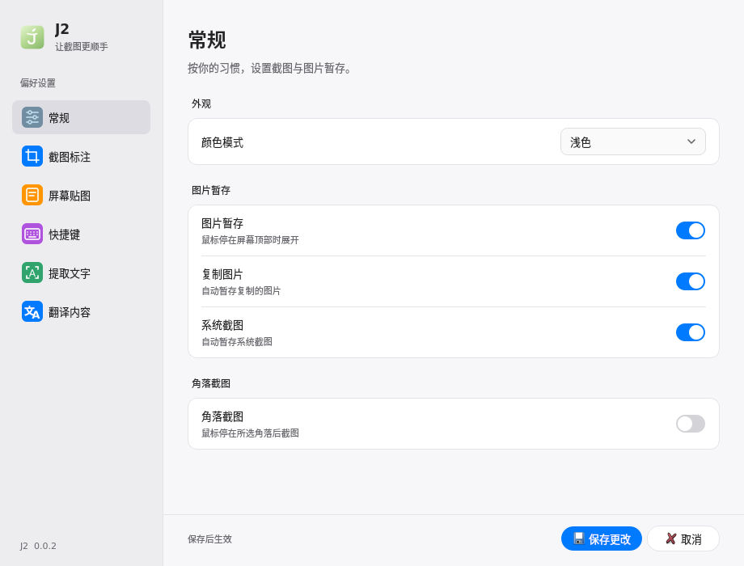
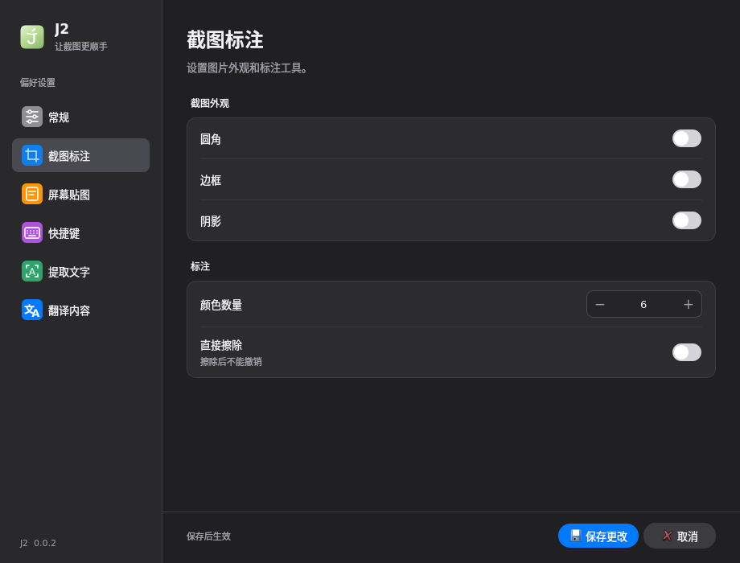
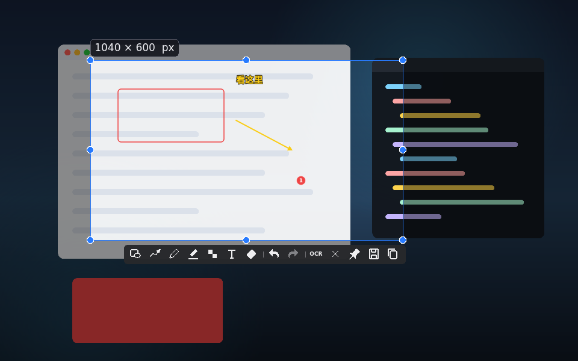
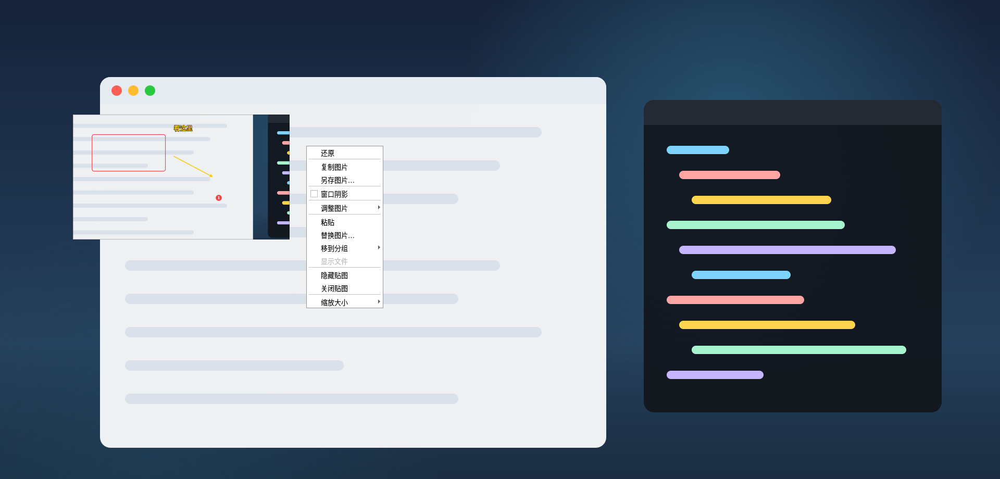

# ARM64 / Qt5 兼容性验证（2026-10-25）

结论：本次适配已在 Ubuntu 20.04 ARM64 的旧版构建与运行环境中通过验证，
**尚未在银河麒麟 V10 设备上运行**。以下截图均由该 ARM64 环境的真实 Qt 控件生成，
不是麒麟 UKUI 桌面截图。

## 环境与成品

- 构建环境：Linux aarch64，GCC 9.4.0，CMake 3.16.3，Qt 5.12.8，glibc 2.31。
- 运行检查：虚拟 X11 桌面；另使用没有开发工具的全新 Ubuntu 20.04 ARM64 容器安装成品。
- 成品：`dist/kylin-v10-arm64/jie2_0.0.2_arm64.deb`，394936 字节，包内架构 `arm64`。
- SHA-256：`2aa1bdd25a68710005c2133f6faa54a79b5be1b7c15ce238b08c9f2813f85a05`。
- 包内根目录、程序目录权限为 0755，普通用户可以读取和启动。

## 实际结果

| 检查 | 结果 |
| --- | --- |
| 正式入口 `bash scripts/build-kylin-arm64.sh --docker` | 从全新目录构建、测试、打包及安装卸载检查全部通过 |
| 已有三组测试 | 全部通过；界面测试 75 项通过、0 项失败、2 项仅限 macOS 的检查跳过 |
| 界面交互 | 设置选择框、数字输入、主题切换、菜单、截图标注、贴图等检查通过 |
| 启动自检 | 界面初始化、PNG 读写、HTTPS 支持通过；不涉及外部服务连通性 |
| 全局快捷键 | 虚拟 X11 下注册成功，模拟按键触发回调成功 |
| 截图与贴图 | 输出尺寸正确；旋转、翻转、反色和保存通过图片内容检查 |
| 鼠标键盘完整操作 | 框选、矩形、箭头、文字、序号、撤销、重做、换色、擦除、保存通过 |
| 输出图片核对 | 400×300；矩形红色像素 151/151；箭头黄色像素 390；被擦区域红色像素 0 |
| 旧版回收站兼容 | 中文文件名移入回收站后内容一致；文件不存在或工具缺失时返回失败，保留原文件 |
| 干净环境安装 | 仅安装成品声明的运行依赖与测试工具，启动、截图通过，无缺失运行库 |
| 普通用户运行 | `nobody` 用户启动自检通过 |
| 重复安装与卸载 | 检查通过；程序、菜单入口和图标移除，测试配置保留 |
| 现有 macOS 版本 | 重新构建成功，已有三组测试全部通过 |
| 失败场景 | 指定 Qt5 缺失时配置失败；非 Linux ARM64 直接构建被拒绝 |

主程序实际需要的最高版本标记为 `GLIBC_2.29`、`GLIBCXX_3.4.22`，
未超出选定旧环境的兼容性上限。Qt、OpenSSL 等运行库仍由目标设备的软件源提供。

## 可复查证据

- [正式构建、测试、安装卸载记录](build-and-install.txt)
- [Qt5 控件测试详情](qt5-tests.txt)
- [鼠标键盘操作和图片核对](interactive.txt)
- [macOS 回归记录](macos-regression.txt)
- [安装脚本补充复测](install-recheck.txt)

## 实机边界

麒麟 UKUI 托盘、设备实际快捷键冲突、不同缩放比例与多显示器、显卡驱动、Wayland 门户，
还需在目标麒麟设备验收。本记录不代表麒麟实机验证通过或取得兼容性认证。
设备安装与检查步骤见[适配说明](../../kylin-v10-arm64.md)。
