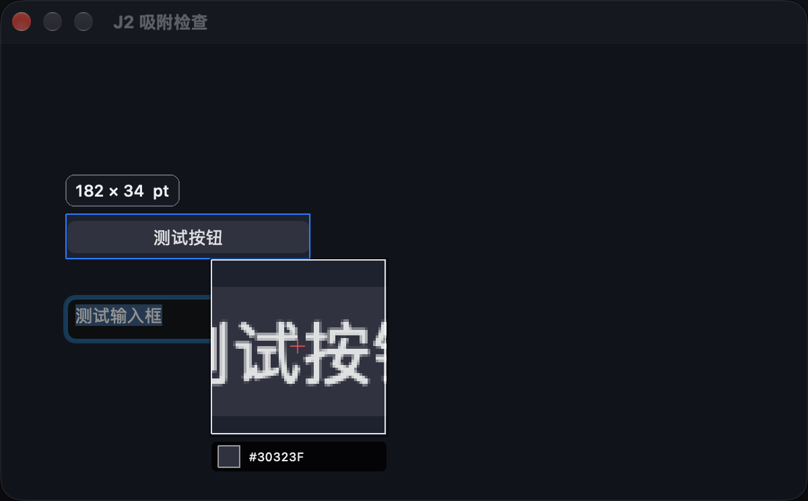

# 截图吸附

截图时，把鼠标移到窗口、按钮或输入框上，即可预览可选范围。

- 单击固定选区，再按原来的方式复制或保存。
- 滚轮向下扩大范围，向上缩小范围，可在元素、上级区域和窗口之间切换。
- 直接拖动仍可手动框选，靠近窗口边缘时保留边缘吸附。
- 按住 Option 临时关闭吸附，松开恢复。
- F5 刷新画面时同步刷新窗口和元素范围。
- 查看历史截图或编辑图片时，不吸附当前桌面的窗口。

## 识别范围

macOS 的按钮、输入框等元素识别需要允许“辅助功能”，可从菜单的“功能检查”中点击“允许识别”。没有权限时仍可吸附整个窗口，不会在每次截图时弹出授权请求。

只有应用向系统提供了元素范围，才能单独选中该元素。无法识别、窗口位置变化或查询失败时，保留窗口选区。鼠标快速移动时丢弃过期结果，避免预览跳到旧位置。

## 验证记录

- 完整构建通过，全部三组自动检查通过。
- 已验证重叠窗口、屏幕边缘、元素层级切换、Option 临时关闭、自由拖动、延迟结果、刷新及历史图片模式。
- 在真实 macOS 桌面上打开独立测试应用，识别测试按钮，点击并完成实际屏幕裁剪；选区为 182 × 34 点，输出为 364 × 68 像素。
- 检查预览及输出图片，按钮边缘和文字完整，输出没有带入选区线或放大镜。
- 应用启动检查通过。

验证图片只包含测试应用的窗口和按钮。

